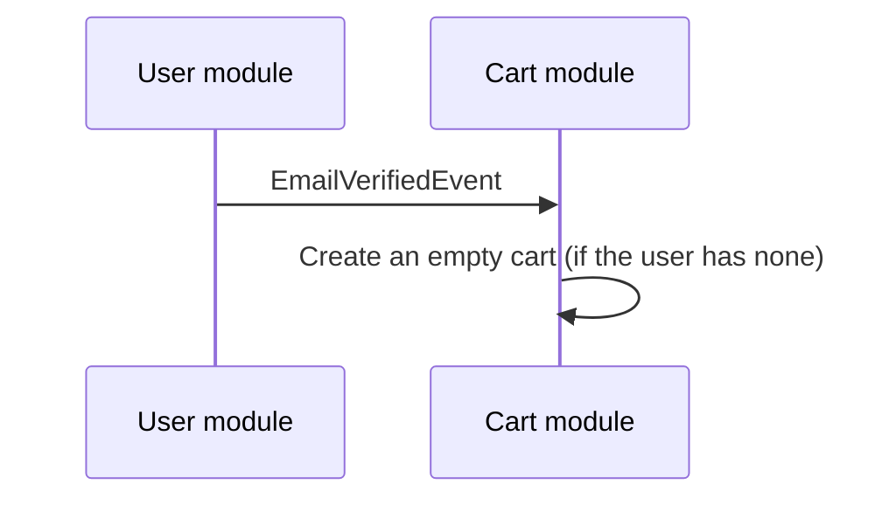

# Cart module

## Rules

- **One cart per user**, enforced by a unique constraint on the user as well as by the code.
- **A variant appears at most once** in a cart. Adding it again increases the existing item.
- **Quantity of an item is between 1 and 99.** To get rid of an item, delete it; a quantity of 0 is not allowed.
- **Only variants that are for sale can be added or have their quantity set.** A variant is for sale when it exists and its product is published. Removing an item or clearing the cart does not need this, so a customer can always get rid of something that was withdrawn.
- **The cart is created when the user's email is verified**, and also on demand: adding or updating an item, or merging a guest cart, creates it if it does not exist.

The three ways to change a quantity behave differently:

| Action | If the variant is already in the cart | If it is not | Above 99 |
|---|---|---|---|
| **Add** | The quantity is added to the existing item | A new item | Rejected |
| **Set quantity** | The quantity is replaced | A new item | Rejected |
| **Merge** (guest cart) | The existing quantity is kept | A new item | Lowered to 99 |

### Concurrent requests

A user can send several cart requests at once, for example by double-clicking "add". To keep them from overwriting
each other or from both creating a cart, every change first takes a **per-user lock** (a PostgreSQL advisory
transaction lock keyed by the user id) and releases it when its transaction ends. Requests of the same user then run
one after another; requests of different users do not wait for each other. A lock on the cart row would not work,
because the row may not exist yet.

## Creating the cart when an email is verified

The cart module listens to an event from the user module and creates the user's empty cart.

