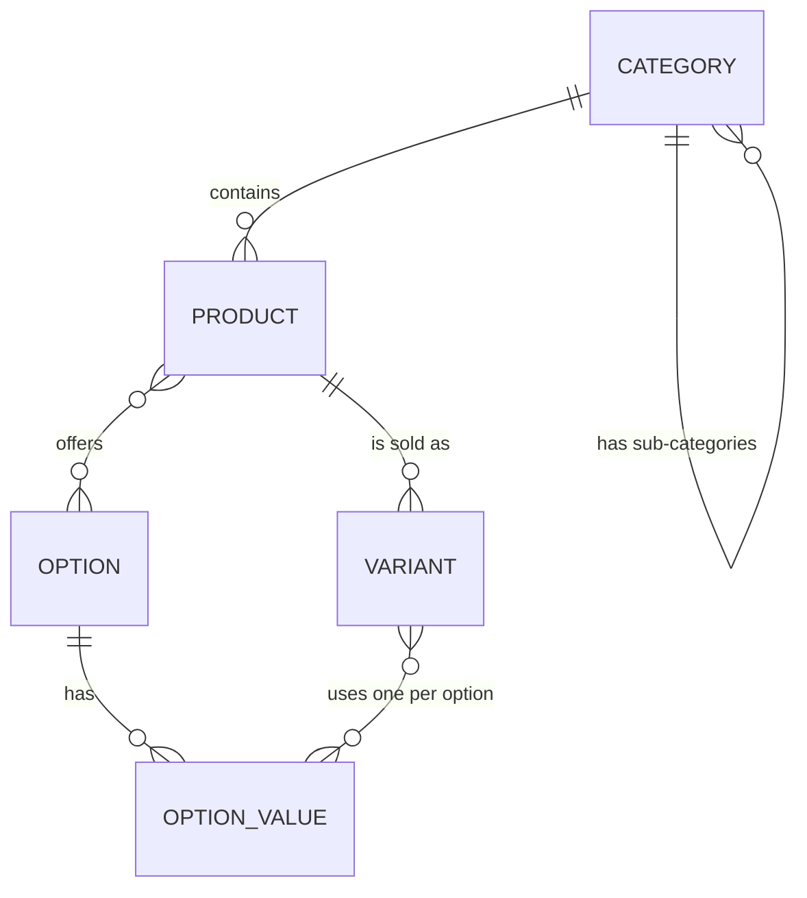
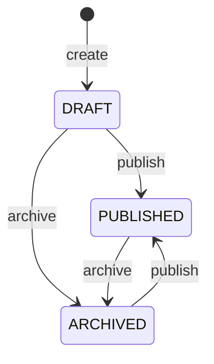

# Catalog module

The catalog is where products are defined: what is sold, how it is organised and in which variants it can be bought.
It owns categories, options, products and variants. Other modules only see the small API in
[Published API](#published-api).

For endpoint details (parameters, bodies, errors) use the Swagger UI at `/swagger-ui.html`; this page explains the
concepts and rules behind it.

- [Concepts](#concepts)
- [Rules](#rules)
- [Product lifecycle](#product-lifecycle)
- [Reading data](#reading-data)
- [Product search](#product-search)
- [API](#api)
- [Published API](#published-api)
- [Code layout](#code-layout)
- [Tests](#tests)

## Concepts

| Concept | What it is | Example |
|---|---|---|
| **Category** | A node in a tree. It defines the *attributes* products in it can have. | Clothes › Shirts |
| **Attribute** | A fact about a product, defined by a category: a code, a label, a type and the allowed values. | `material`: cotton, wool |
| **Option** | A reusable choice that creates variants, with a list of values. Shared by all products. | Color: Red, Blue |
| **Product** | What is shown and managed: name, slug, description, category, attributes, options, media and variants. | "Plain shirt" |
| **Variant** | One buyable version of a product, with its own SKU, price, size and weight. It has exactly one value for each option of the product. | SKU `SHIRT-RED-S`: Red / S |

Attributes and options look similar but do different jobs. An **attribute** describes a product and is used to filter
(material is cotton). An **option** splits a product into variants that are bought separately (Red or Blue, S or M).



## Rules

### Categories

- The tree is stored as a path: a category keeps the ids of its ancestors, for example `1.5.`, so descendants can be found with one query.
- The slug is unique and has the form `t-shirts` (lowercase letters, digits and single hyphens).
- **Attributes are inherited.** A sub-category has its own attributes plus those of all its ancestors, so it cannot reuse an attribute code that an ancestor has, and an ancestor cannot take a code a descendant already uses.
- An attribute code has 2 to 50 lowercase letters, digits or underscores. An attribute is either `SINGLE` (a product has exactly one value) or `MULTI` (one or more).
- **Attributes can grow, but not shrink.** Because products already use them, an update may add attributes and add values, but it cannot remove an attribute, remove a value, or change an attribute's type.
- A category can be deleted only if it has no sub-categories and no product uses it.

### Options

- Option names are unique. Value names are unique within one option.
- An option can be deleted only if no product uses it. A value can be removed only if no product uses it.

### Products and variants

- A product's attributes must match its category's attributes (including inherited ones): every code must exist and every value must be an allowed one.
- A new product is a draft with no options, media or variants. Everything is added afterwards.
- **Options of a product.** Adding an option gives it a first value, which every existing variant receives. More values can be added later. An option can be removed only when one value is left, and a value can be removed only if no variant uses it. Options and their values keep a display order that can be changed.
- **Media.** The gallery is an ordered list of image keys. An image used by a variant cannot be removed. Images are uploaded straight to storage with a presigned URL, then added by key.
- **Variants.** A variant must give exactly one value for each option of the product, and no two variants of a product have the same combination. A product without options can have one variant. The SKU is unique across the whole catalog.
- **Price.** A variant has a price and an optional compare-at price that is never lower than the price. Size is in positive whole centimetres and weight in positive whole grams.
- A variant can use one image of the product's gallery, or none.

## Product lifecycle



- Publishing or archiving a product that already has that status changes nothing.
- A product **cannot go back to `DRAFT`**.
- Only a `DRAFT` can be deleted, and variants can be removed only while the product is a `DRAFT`.
- Only `PUBLISHED` products appear in the storefront search and can be bought. A product that is not a draft can still be opened by its slug.

## Reading data

Changes go through the domain model and use cases, which enforce the rules above. Reads are separate: query services
run SQL directly and return flat view records shaped for the screens, with no domain objects involved.

- **Storefront search** returns published products only. It supports a keyword, category, price range, option values and attribute filters (`attr_{code}=value`), and sorting by price or name. See [Product search](#product-search) for how the keyword search works. With `fullFacets=true`, facet counts ignore the filters already chosen.
- **Filter sidebar** returns the price range, sub-categories, option values and attributes available for the products that match a search.
- **Admin lists** search by name or SKU, filter by status and category, and show how many products are in each status.
- **Variant lookup** finds variants by product name or SKU, for example to pick a variant in another screen.

## Product search

The storefront search (`GET /products`) and the filter sidebar (`GET /products/filters`) use the same conditions, so
the sidebar always describes the products the search returns. Only `PUBLISHED` products are searched.

### Keyword

The keyword is compared with the product **name** only. A product matches if **any** of these three tests passes, so
the search finds whole words and also forgives typos and partial words:

| Test | What it finds | Example (product "Cotton Shirt") |
|---|---|---|
| **Full-text search** | Whole words. The keyword is split into words, and all of them must appear in the name, in any order. | `shirt cotton` |
| **Trigram similarity** | A name that looks similar to the whole keyword, so a small typo still matches. | `cotton shrit` |
| **Word similarity** | A keyword that looks like a part of the name, so a short or unfinished word matches. | `cott`, `shir` |

**Accents are ignored** in all three tests, so `ao thun` finds "Áo thun". The name and the keyword both go through
PostgreSQL's `unaccent`.

**Full-text search** turns the name and the keyword into lists of words and checks that the keyword's words are in the
name. It uses the `simple` configuration, which does not reduce words to a root (so full-text alone does not match
`shirts` to `shirt`; the similarity tests below do) and does not drop common words, because product names mix languages. The keyword is read in web-search style: words
are combined with *and*, `"a phrase in quotes"` must appear together, `or` allows either word, and `-word` excludes
a word.

**Trigram search** (PostgreSQL's `pg_trgm`) cuts a text into overlapping groups of three letters and measures how many
groups two texts share. `shirt` becomes `  s`, ` sh`, `shi`, `hir`, `irt` and `rt ` (the word edges are padded with
spaces), and a typo such as `shrit` still shares several of them. Two measures are used:

- *similarity* compares the keyword with the whole name;
- *word similarity* compares the keyword with the best-matching part of the name, so it is not hurt by the rest of a long name.

Both need a score above a threshold to count as a match. The default for similarity is `0.3`; for word similarity the
application sets `0.4` on the database at startup. A higher value is stricter and gives fewer, closer matches.

### Order of results

- With a keyword and no `sortBy`, results are ordered by **relevance**: `2 × full-text rank + the better of the two similarity scores`, highest first. A name that contains the words typed therefore tends to come before one that is merely similar.
- `sortBy=price_asc`, `price_desc` or `name_asc` replaces relevance. Any other value falls back to the default.
- Without a keyword, the default is newest first. Ties are broken by newest first.

### Admin search

The admin product list does not use any of this. It matches the keyword with a simple, accent-insensitive "contains"
test on the product name or on a variant's SKU, and does not rank results, because admins usually look for something
they already know.

## API

Public, no login (`GET` only):

| Method | Path | Purpose |
|---|---|---|
| GET | `/categories` | Category tree |
| GET | `/products` | Search products |
| GET | `/products/filters` | Filter options for a search |
| GET | `/products/{slug}` | Product detail |

Admin, for roles `ADMIN` and `STAFF`:

| Area | Endpoints under `/admin` |
|---|---|
| Categories | `POST/GET /categories`, `GET/PUT/DELETE /categories/{id}`, `GET /categories/{id}/effective-attributes`, `PUT /categories/{id}/attributes` |
| Options | `POST/GET /options`, `GET/PUT/DELETE /options/{id}`, `POST /options/{id}/values`, `PUT/DELETE /options/{optionId}/values/{valueId}` |
| Products | `POST/GET /products`, `GET /products/status-counts`, `GET/PUT/DELETE /products/{id}`, `PATCH /products/{id}/status` |
| Product media | `POST /products/media/presign`, `POST/DELETE /products/{id}/media`, `PUT /products/{id}/media/reorder` |
| Product options | `POST /products/{id}/options`, `DELETE /products/{id}/options/{optionId}`, `PUT .../options/reorder`, `POST .../options/{optionId}/values`, `DELETE .../options/{optionId}/values/{valueId}`, `PUT .../options/{optionId}/values/reorder` |
| Variants | `POST /products/{id}/variants`, `PUT/DELETE /products/{id}/variants/{variantId}`, `GET /variants/lookup` |

Errors use the standard problem format: `400` for invalid input or a rule that forbids the action, `404` when something
does not exist, and `409` when a name, slug or SKU is already taken.

## Published API

Other modules must not read catalog tables. Catalog offers three small interfaces in `catalog.published` instead:

| Interface | Question it answers | Used by |
|---|---|---|
| `VariantExistenceChecker` | Which of these variants do not exist? | inventory (receiving goods) |
| `VariantSaleChecker` | Which of these variants cannot be bought (missing, or product not published)? | cart |
| `SellableVariantFinder` | What do these buyable variants look like now (product name, SKU, options, thumbnail, price)? | checkout |

## Code layout

```
catalog/
├── domain/          Category, Option, Product, Variant and their rules; repository interfaces
├── application/     One use case per action (CreateProductUseCase, AddProductVariantUseCase, ...) and its command
├── query/           Read-side interfaces and the view records they return
├── published/       The interfaces other modules may use
├── inbound/rest/    Controllers and OpenAPI annotations
└── infrastructure/
    ├── persistence/ JPA entities and repository implementations
    ├── query/       SQL behind the query services
    └── published/   SQL behind the published interfaces
```

Dependencies point inwards: `domain` knows nothing about Spring or the database, and `application` depends only on
`domain`.

## Tests

| Kind | What it covers | How |
|---|---|---|
| Domain | The rules of category, attribute, option, product and variant | Plain JUnit, no Spring |
| Use case | Each use case: the happy path, and every error leaves nothing saved | JUnit with Mockito repositories |
| Persistence | Repositories against a real PostgreSQL: saving and reloading everything, ordering, unique and foreign-key constraints | Testcontainers, one container shared by the whole test run |

Run them with `./gradlew test`; the persistence tests need Docker.
