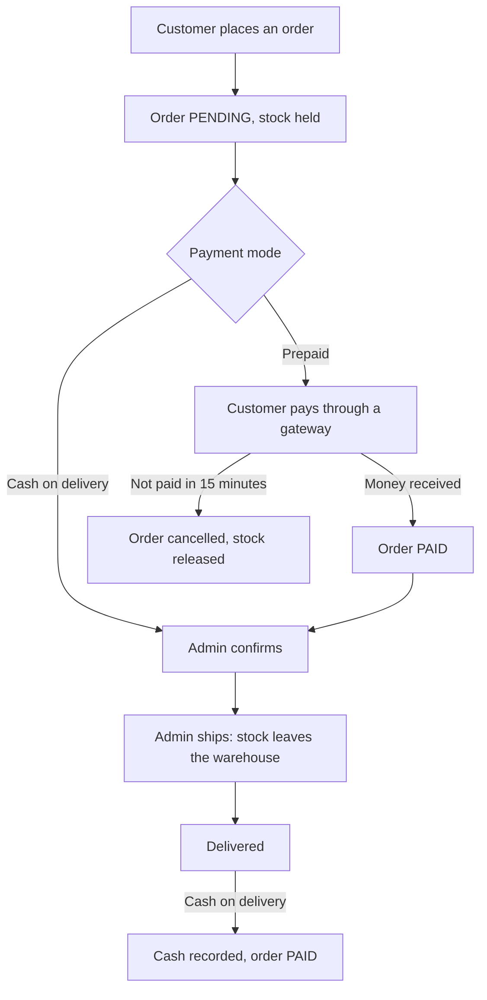
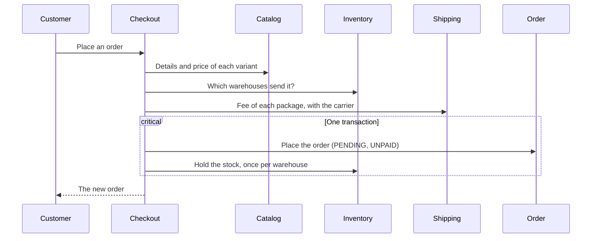
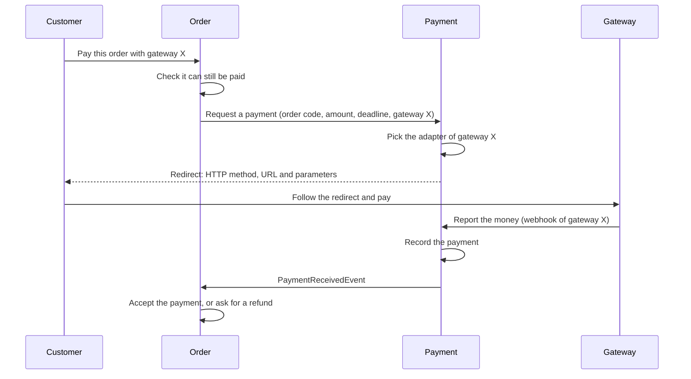
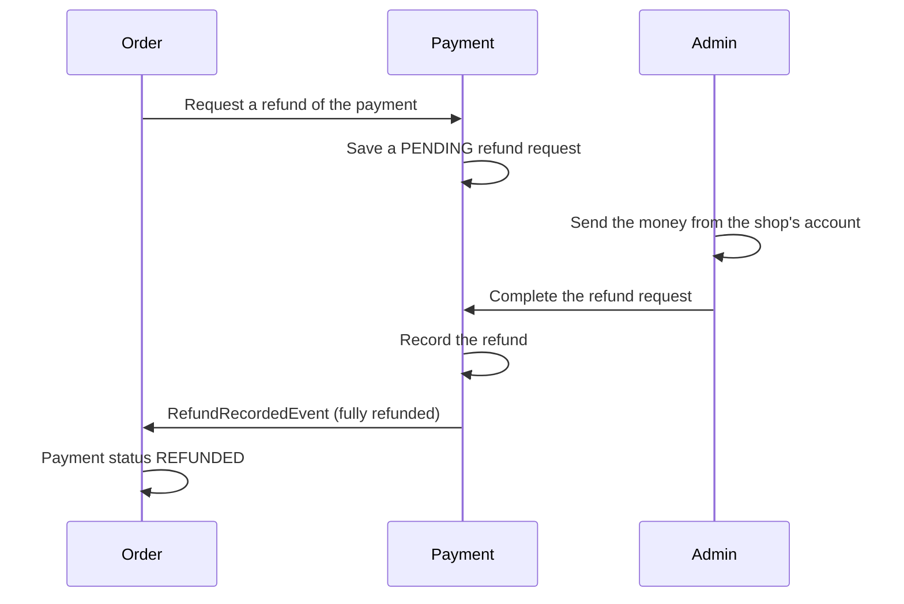

# From checkout to payment

This page follows one purchase from the moment the customer presses "place order" until the money is received, across the
checkout, inventory, shipping, order and payment modules. Each module has its own page with its rules; this page shows
how they fit together.

- [Overview](#overview)
- [1. Placing the order](#1-placing-the-order)
- [2. Paying](#2-paying)
- [3. After payment](#3-after-payment)
- [When the customer does not pay](#when-the-customer-does-not-pay)
- [When the order is cancelled or returned after paying](#when-the-order-is-cancelled-or-returned-after-paying)

## Overview

| Step | Cash on delivery | Prepaid |
|---|---|---|
| Place the order | Order `PENDING`, `UNPAID` | Order `PENDING`, `UNPAID`, 15 minutes to pay |
| Pay | When the order is delivered | Before confirmation, through a gateway |
| Confirm | Right away | Only after it is `PAID` |

## 1. Placing the order

The client sends only variant ids and quantities, the recipient and address, a carrier and the payment mode. Prices
come from the catalog.

- A variant that is not for sale, an unknown carrier or too little stock stops the checkout before anything is saved.
- If the stock is taken between choosing the warehouses and holding it, the hold fails and the order is rolled back.
  The customer gets an out of stock error and no order exists.
- The order's total is the items plus the shipping fee. A total of 0 is paid from the start.

See [Checkout](checkout.md) for the rules of this step.

## 2. Paying

A cash on delivery order skips this step. For a prepaid order the customer asks to pay and is sent to the gateway they
picked. Nothing is saved when they ask, so it can be repeated, with the same gateway or another, until the order is paid
or its time is over.

The order can be paid online only while it is prepaid, `UNPAID`, `PENDING` and before its deadline. The redirect differs
per gateway: it may be a plain URL, or a signed form that the customer's browser posts. The customer follows it exactly
as given, because gateways sign the values and refuse a changed amount. The gateway passes the order code back when it
reports the money, so the payment is matched to the order.

The order becomes `PAID` only when the gateway reports the money, never because the customer came back to a success page.

The payment is recorded whatever the order's state, since the money really moved. The order then decides:

| Result | What happens |
|---|---|
| Accepted | The order is `PAID`. |
| Same payment again | Nothing changes. |
| Rejected: paid twice, already refunded, order closed, deadline passed or wrong amount | The payment is sent back through a [refund request](#when-the-order-is-cancelled-or-returned-after-paying). |
| No order has this code | The money waits unmatched until a person assigns it to an order. |

See [Payment](payment.md) and [Order](order.md) for the details of each side.

## 3. After payment

1. **Confirm.** An admin confirms the order. A prepaid order must be `PAID` first.
2. **Ship.** The goods are handed to the carrier and the held stock leaves the warehouse.
3. **Deliver.** For cash on delivery, the cash collected by the carrier is recorded as a payment at this point, and the
   order becomes `PAID` like any other payment.

## When the customer does not pay

A job runs every minute and cancels prepaid orders whose 15 minutes are over, with the reason "Payment expired", and the
held stock is released. A payment that arrives after the deadline is rejected and refunded even if the job has not run yet,
because the order checks its own deadline.

## When the order is cancelled or returned after paying

The order asks payment to give the money back in full. Payment saves a refund request. A person sends the money from the
shop's account, then completes the request, which records the refund. When the whole payment is refunded, the order
becomes `REFUNDED`.

