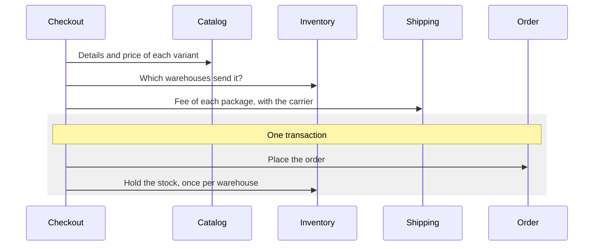

# Checkout module

Checkout turns what the customer picked into an order. It stores nothing itself: it asks the catalog, inventory and
shipping modules what they know, then asks the order and inventory modules to place the order and hold its stock. For
endpoint details (parameters, bodies, errors) use the Swagger UI at `/swagger-ui.html`; this page explains the
concepts and rules behind it.

- [Rules](#rules)
- [Placing an order](#placing-an-order)
- [Why some steps run outside the transaction](#why-some-steps-run-outside-the-transaction)
- [When it fails](#when-it-fails)
- [API](#api)

## Rules

- **The client sends only ids and quantities.** Product name, SKU, options, thumbnail and price are read from the
  catalog and copied into the order, so a customer cannot choose a price.
- **A variant listed twice becomes one order line**, with the quantities added.
- **Only variants that are for sale can be ordered**: the variant exists and its product is published.
- **The warehouses are chosen for the customer.** As few as possible send the order, and one in the destination
  province is preferred.
- **The shipping fee is the sum of one package per warehouse**, priced by the carrier the request names.
- **The order and its stock hold are created together.** If any line cannot be held, there is no order.
- **A prepaid order must be paid within 15 minutes**, or it is cancelled and its stock released. A cash on delivery
  order has no deadline.

## Placing an order

Choosing warehouses only reads, and it does not hold anything. The hold happens in the last step, once per warehouse in
ascending warehouse id order.

## Why some steps run outside the transaction

The first three steps only read. The shipping fee may call a carrier over the network, which can be slow, so these
steps run before the transaction opens and a slow carrier does not keep a database connection busy.

The price is a gap: between choosing the warehouses and holding the stock, another customer may take the last unit.
The hold then fails and rolls the order back, so the customer gets an out of stock error and no order exists. Nothing
is left half done.

## When it fails

| Cause | Result |
|---|---|
| Invalid recipient, phone number, address or items | 400 |
| A variant is missing or its product is not published | 400 |
| The carrier is unknown, or shipping lacks the address of a warehouse or the size and weight of a variant | 400 |
| A variant has too little stock in all active warehouses together | 409 |
| The stock was taken between choosing the warehouses and holding it | 409, and the order is rolled back |

## API

| Endpoint | What it does |
|---|---|
| `POST /checkout` | Place an order for the current user and return it |
