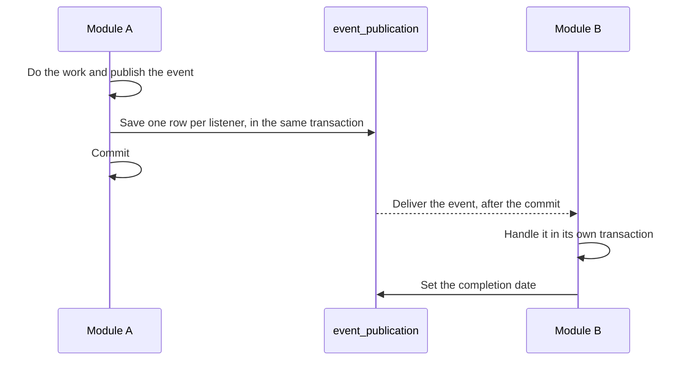

# Event publication registry

Modules tell each other that something happened with events: payment records the money and publishes
`PaymentReceivedEvent`, and order reacts to it without payment knowing the order module. A listener can crash, or the
application can stop before it runs, so events are not only kept in memory. Spring Modulith saves each one in the
`event_publication` table and keeps it there until its listener is done.

- [How an event is saved and delivered](#how-an-event-is-saved-and-delivered)
- [When a listener fails](#when-a-listener-fails)
- [Retrying](#retrying)
- [Writing a listener](#writing-a-listener)
- [Current state](#current-state)

## How an event is saved and delivered

1. **Save with the publisher.** The event is written in the same transaction as the publisher's changes, one row for each
   listener, with the event type, the event serialized as JSON, the listener and the publication date. If the
   transaction rolls back, the rows roll back with it, so no listener gets an event for work that did not happen.
2. **Run the listener** after the transaction commits.
3. **Complete.** When the listener finishes without an error, its row gets a completion date.

## When a listener fails

A row without a completion date means the listener has not finished: it threw an exception, or the application stopped
before it ran. The failure does not undo the publisher's work, which is already committed. The event is not lost,
because it is still in the table, and it can be delivered again.

## Retrying

There are two ways to deliver the incomplete events again:

- **On restart.** With `spring.modulith.events.republish-outstanding-events-on-restart=true`, every incomplete event is
  resubmitted to its listener when the application starts.
- **On demand.** The `IncompleteEventPublications` bean resubmits incomplete events, all of them or only those older
  than a given duration, so a scheduled job can retry them while the application is running.

## Writing a listener

A listener is a method annotated with `@ApplicationModuleListener`, in the `inbound/listener` package of the module that
reacts. It runs after the publisher's transaction has committed, asynchronously, and in a transaction of its own.

Because an event can be delivered more than once, a listener must be safe to run twice with the same event. The use cases
the listeners call are written that way: asking for a state that already holds changes nothing.

## Current state

Retry is not switched on in this project yet: the property above is off by default and nothing calls
`IncompleteEventPublications`, so an incomplete event stays in the table until one of the two is set up.
