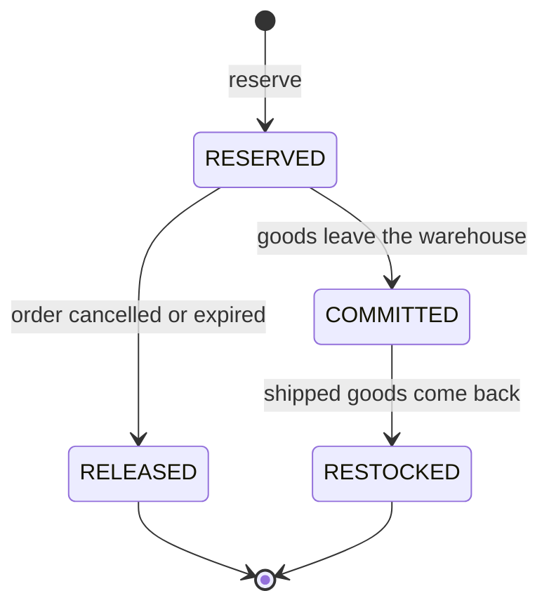

# Inventory module

The inventory module knows how many units of each variant every warehouse has, holds units for orders, and keeps a
ledger of every change. For endpoint details (parameters, bodies, errors) use the Swagger UI at `/swagger-ui.html`;
this page explains the concepts and rules behind it.

- [Concepts](#concepts)
- [Rules](#rules)
- [Reservation lifecycle](#reservation-lifecycle)
- [Receiving goods](#receiving-goods)
- [Choosing warehouses](#choosing-warehouses)
- [Concurrent requests](#concurrent-requests)
- [API](#api)

## Concepts

| Concept | What it is |
|---|---|
| **Warehouse** | A place that keeps stock, with a unique code (`HN-01`) and an address. It is active or inactive. |
| **Inventory item** | The stock of one variant in one warehouse: `onHand` units in the building, `reserved` of them held for orders. |
| **Available** | `onHand - reserved`: what can still be sold. |
| **Reservation** | The units held for one order in one warehouse. An order that ships from two warehouses has two. |
| **Ledger entry** | One line of the stock ledger: what changed, how much, both quantities afterwards, and the document that caused it. |

## Rules

- **`0 <= reserved <= onHand`** always. A reservation fails when it would need more than is available.
- **A warehouse code is unique and never changes.** It is trimmed and upper-cased; 2-50 letters, digits, `_` or `-`.
- **An inactive warehouse takes no new goods and no new reservations.** Reservations it already holds can still be released, committed or restocked.
- **The ledger is append-only.** Entries are never updated or deleted, and each one stores the quantities after the change.
- **Every change goes through a reservation or a receipt.** Reserve, release, commit and restock are not exposed over HTTP; they are driven by the order flow. Only goods receipts are done by an admin.

## Reservation lifecycle

| Step | `onHand` | `reserved` | Ledger entry |
|---|---|---|---|
| **Reserve** | unchanged | + quantity | `RESERVE` |
| **Release** | unchanged | - quantity | `RELEASE` |
| **Commit** | - quantity | - quantity | `COMMIT` |
| **Restock** | + quantity | unchanged | `RESTOCK` |

Release, commit and restock work on every reservation of an order. A reservation already in the target status is
skipped without changes, so a repeated call (for example a redelivered event) is harmless. Any other move, such as
releasing a committed reservation, is rejected.

Reserving the same order in the same warehouse twice does nothing the second time. Duplicate variants in a request are
summed.

## Receiving goods

An admin records a receipt with a **receipt code**, the warehouse and the variants with their quantities. Each variant
adds to `onHand` (the item is created the first time the warehouse stocks the variant) and writes a `RECEIVE` entry.

A receipt code can be used **once per warehouse**. Sending the same receipt again, because of a double click or a
retry after a timeout, is rejected with a conflict instead of counting the goods twice. The variants must exist in the
catalog and the warehouse must be active; a failed receipt changes nothing.

## Choosing warehouses

Each warehouse an order ships from is one more package to pay shipping for, so the allocator uses as few as it can:

1. Take the warehouse that can send the most of what is still missing. On a tie, prefer one in the destination
   province, then the lowest id.
2. Repeat with what is left until nothing is missing.

A warehouse that has everything always wins the first round, so the order ships as one package. This is greedy: fine
for a handful of warehouses, but not always the fewest possible. Only active warehouses with available stock take part,
and the province is compared as plain text, ignoring case and surrounding spaces.

Allocating only reads. Holding the stock is a separate step, once per warehouse in ascending id order, and it fails if
someone took the stock in between.

## Concurrent requests

Two requests must not both take the last unit. Every change first loads the affected items with a **row lock**
(`SELECT ... FOR UPDATE`) and works on them until its transaction ends. To avoid deadlocks, locks are always taken in
the same order: reservations by warehouse id, then items by variant id.

## API

| Endpoint | What it does |
|---|---|
| `GET /admin/warehouses`, `GET /admin/warehouses/{id}` | List or read warehouses |
| `POST /admin/warehouses` | Create a warehouse |
| `PUT /admin/warehouses/{id}` | Change name and address |
| `PATCH /admin/warehouses/{id}/status` | Activate or deactivate |
| `POST /admin/inventory/receipts` | Receive goods |
| `GET /admin/inventory/stock` | Search stock, optionally only what is low or out |
| `GET /admin/inventory/availability` | Sellable units of variants per active warehouse |
| `GET /admin/inventory/ledger` | Search the ledger |
| `GET /admin/inventory/reservations` | The reservations of an order |
