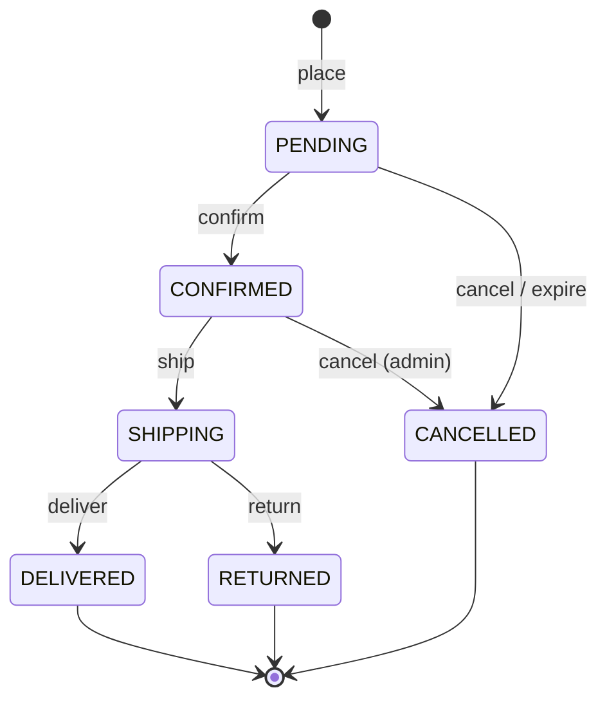
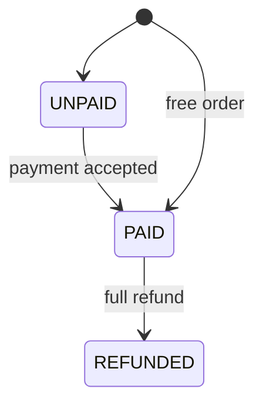

# Order module

The order module keeps what a customer bought and follows it from placing to delivery, return or cancellation. For
endpoint details (parameters, bodies, errors) use the Swagger UI at `/swagger-ui.html`; this page explains the
concepts and rules behind it.

- [Concepts](#concepts)
- [Rules](#rules)
- [Order status](#order-status)
- [Payment status](#payment-status)
- [Prepaid and cash on delivery](#prepaid-and-cash-on-delivery)
- [Payments and refunds](#payments-and-refunds)
- [Stock](#stock)
- [Events](#events)
- [API](#api)

## Concepts

| Concept | What it is |
|---|---|
| **Order** | One purchase by one user, with a unique order code, a recipient, a shipping address and items. |
| **Order item** | A copy of the variant as it was when ordered: product name, SKU, options, thumbnail, unit price and quantity. Later catalog changes do not touch it. |
| **Order status** | Where the order is in fulfillment: `PENDING`, `CONFIRMED`, `SHIPPING`, `DELIVERED`, `RETURNED` or `CANCELLED`. |
| **Payment status** | Whether the money was received: `UNPAID`, `PAID` or `REFUNDED`. |

The two statuses are separate. A cash on delivery order is shipped while still `UNPAID`; a prepaid order must be
`PAID` before it can be confirmed.

## Rules

- **An order has at least one item.** The total is the sum of the items plus the shipping fee, and it is fixed when the order is placed.
- **Orders are created by checkout**, which resolves prices, the shipping fee and the stock hold first. The order module does not price anything.
- **Every status change is idempotent.** Asking for the status the order already has changes nothing and sends no event, so a retry or a redelivered event is harmless.
- **A customer sees only their own orders.** Someone else's order is reported as not found, not as forbidden.
- **A free order (total 0) is paid from the start**, without any payment record.

## Order status

`DELIVERED`, `RETURNED` and `CANCELLED` are final. Any other move is rejected.

| Action | Who | From | What else happens |
|---|---|---|---|
| **Confirm** | Admin | `PENDING` | A prepaid order must be `PAID` first. |
| **Ship** | Admin | `CONFIRMED` | The reserved stock is deducted from the warehouses. |
| **Deliver** | Admin | `SHIPPING` | For cash on delivery, the cash is recorded as a payment and the order becomes `PAID`. |
| **Return** | Admin | `SHIPPING` | The goods are put back in stock; a refund is requested if the order was paid. |
| **Cancel** | Customer | `PENDING` | The reserved stock is released; a refund is requested if the order was paid. |
| **Cancel** | Admin | `PENDING`, `CONFIRMED` | Same as above, with a required reason. |
| **Expire** | Scheduled job | `PENDING`, prepaid, unpaid, past its deadline | Cancelled with the reason "Payment expired"; the stock is released. |

## Payment status

## Prepaid and cash on delivery

| | Prepaid | Cash on delivery |
|---|---|---|
| **Deadline** | Must be paid within 15 minutes, or it is cancelled | None |
| **Confirm** | Only after it is `PAID` | Right away |
| **Payment** | Online, through the gateway the customer picks | Cash, recorded when the order is delivered |

A customer asks to pay a prepaid order, and gets where to go on the gateway. This changes nothing, so it can be repeated
(closed page, failed payment) until the order is paid or the time is over. The order becomes `PAID` only when the
payment module reports the money, never because the customer came back to a success page.

The expiry job runs every minute, so an unpaid order is cancelled within about a minute after its deadline. A late
payment does not depend on the job: the order checks its own deadline. If one order fails to expire, it is logged and
tried again on the next run without stopping the others. Several instances can run the job at once, because each order
is locked and expired only once.

## Payments and refunds

The order listens for events from the payment module. Money has already moved by then, so the order never throws
for a payment it cannot accept. It returns a result instead, and for every rejected one the payment is sent back for
a refund.

| Result | Meaning | Refund |
|---|---|---|
| `ACCEPTED` | The order is now `PAID`. | No |
| `DUPLICATE` | The same payment arrived again. | No |
| `REJECTED_ALREADY_PAID` | A second, different payment (the customer paid twice). | Yes |
| `REJECTED_REFUNDED` | The order's money was already given back. | Yes |
| `REJECTED_ORDER_CLOSED` | The order was cancelled or returned first. | Yes |
| `REJECTED_EXPIRED` | The time to pay is over, even if the job has not cancelled the order yet. | Yes |
| `REJECTED_AMOUNT_MISMATCH` | The amount is not the order total. | Yes |
| `ORDER_NOT_FOUND` | No order has this code (for example a mistyped code). | No, a person assigns the money to an order |

When an order is cancelled or returned after it was paid, the order asks for a refund of its own payment. When the
payment module reports a **full** refund of that payment, the order becomes `REFUNDED`. A partial refund leaves it
`PAID`. A refund of another payment (such as a rejected duplicate) does not affect the order, and a full refund of an
order that is neither cancelled nor returned is logged for a person to look at.

## Stock

The order module does not count stock; it asks inventory to do it at each step.

| When | Inventory step |
|---|---|
| Placed | The stock is held in the same transaction (done by checkout). |
| Cancelled or expired | The hold is released. |
| Shipped | The held units leave the warehouse. |
| Returned | The units go back on hand. |

## Events

Each real change publishes an event, so the other modules can react. Events are not published when nothing changed.

| Event | When |
|---|---|
| `OrderPlacedEvent` | The order is created. |
| `OrderPaidEvent` | The payment is accepted. |
| `OrderConfirmedEvent`, `OrderShippedEvent`, `OrderDeliveredEvent` | The status changes. |
| `OrderReturnedEvent`, `OrderCancelledEvent` | The order returns or is cancelled. |
| `OrderRefundedEvent` | The order is refunded. |

## API

| Endpoint | What it does |
|---|---|
| `GET /orders` | List my orders, newest first, optionally by status |
| `GET /orders/{orderCode}` | Get one of my orders |
| `POST /orders/{orderCode}/cancel` | Cancel my order while it is `PENDING` |
| `POST /orders/{orderCode}/payment` | Get where to pay a prepaid order |
| `GET /admin/orders` | Search orders |
| `GET /admin/orders/{id}` | Get an order |
| `POST /admin/orders/{id}/confirm` | Confirm |
| `POST /admin/orders/{id}/ship` | Ship |
| `POST /admin/orders/{id}/deliver` | Mark as delivered |
| `POST /admin/orders/{id}/return` | Mark as returned |
| `POST /admin/orders/{id}/cancel` | Cancel with a reason |
