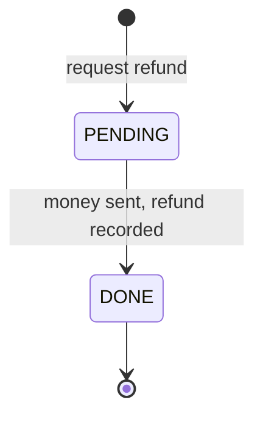

# Payment module

The payment module is the record of money: what came in from customers and what went back out. It also asks gateways
to collect money and receives their reports. It does not decide what a payment means for an order; it records the
money and tells the order module. For endpoint details (parameters, bodies, errors) use the Swagger UI at
`/swagger-ui.html`; this page explains the concepts and rules behind it.

- [Concepts](#concepts)
- [Rules](#rules)
- [Paying through a gateway](#paying-through-a-gateway)
- [Recording a payment](#recording-a-payment)
- [Telling two transfers apart](#telling-two-transfers-apart)
- [Unmatched payments](#unmatched-payments)
- [Refunds](#refunds)
- [Gateways](#gateways)
- [Events](#events)
- [API](#api)

## Concepts

| Concept | What it is |
|---|---|
| **Payment record** | One movement of money for an order. Its type is `PAYMENT` (money received) or `REFUND` (money sent back). |
| **Method** | How the money moved: `COD` (cash on delivery), `BANK_TRANSFER`, `VNPAY` or `SEPAY`. |
| **Shop account** | The shop's account the money went into or out of (bank account number, merchant code). Cash has none. |
| **Transaction number** | The number the bank or gateway gives to a transfer. Cash has none. |
| **Order reference** | The order code the money is for, or none when it could not be found. |
| **Refund request** | Money the shop owes back for one payment, waiting for a person to send it. |
| **Gateway** | An adapter for one way a customer can pay online. It builds the redirect that sends the customer to pay, and its own webhook reports the money back. |

## Rules

- **A payment record never changes.** Like a ledger line, a mistake is fixed with a new record. The one exception is a payment with no order, which a person assigns to an order once.
- **Money is always recorded**, whatever state the order is in, because the money really moved. Whether the order accepts it is the order's decision.
- **The amount is above zero.**
- **Non-cash methods need a transaction number and a shop account.** Cash must have neither.
- **A refund points to exactly one payment.** Refunds can be partial, but all refunds of a payment together never exceed what was received.
- **Recording is idempotent.** The same transfer reported again changes nothing and sends no event.

## Paying through a gateway

The full flow, from the customer's checkout to the money received, is in [From checkout to payment](checkout-to-payment.md#2-paying).
In short: the order module asks payment for a redirect, the customer pays on the gateway, and the gateway's webhook makes
payment record the money and send a `PaymentReceivedEvent`.

Each gateway builds the redirect its own way: it may be a plain URL, or a signed form that the customer's browser posts.
Asking for a redirect saves nothing, so it can be repeated, with the same gateway or another. The customer follows it
exactly as given, since gateways sign the values and refuse a changed amount. The gateway must pass the order code
back when it reports the money, so the payment can be matched to the order. The order is paid only when the gateway
reports the money, never because the customer came back to a success page.

## Recording a payment

Payments reach the module from the gateway webhook, from a bank statement, or from the order module for cash on delivery.
All of them go through one step:

1. If the transfer was already recorded, return it and stop. If the same transfer arrives with a different order or
   amount, reject it as a conflict.
2. Save a new `PAYMENT`.
3. Tell the order module with a `PaymentReceivedEvent`.

The order is not read here. Payment does not know whether an order exists, is cancelled or has expired.

## Telling two transfers apart

Two records are the same transfer when **method, shop account and transaction number** are all equal. The transaction
number alone is not enough: each bank numbers its transfers on its own, so two banks can give the same number to
different customers. With only the number, the second customer's money would look like a repeat of the first and never be
saved, and their order would stay unpaid even though they paid. The shop account tells the banks apart:

```
BANK_TRANSFER, vietcombank_account, 123456   -> saved
BANK_TRANSFER, mb_account,          123456   -> saved too, a different transfer
```

The `payments` table has a unique constraint on these three columns, so a duplicate that slips past the check at the
same moment still fails.

## Unmatched payments

A customer may mistype the order code in a bank transfer, so the money arrives with no order. It is recorded with no
order reference, and the order module ignores it. A person finds the right order and **assigns** the payment to it.
After that the payment is announced just like one that arrived with its code, so the order accepts it or asks for a refund.

A payment is assigned once. Payment does not read orders, so the code is not checked here: if no order has it, the order
side only logs it and the payment keeps that code.

## Refunds

Bank transfers cannot be reversed by any API, so a refund is done by hand in two steps:



1. **Request.** Someone, usually the order module after a cancel or return, asks for a payment to be given back in full.
   A `PENDING` refund request is saved. Nothing happens if the payment already has a pending request or was already
   refunded in full, so the same request can arrive twice.
2. **Complete.** A person sends the money from the shop's account, then completes the request with the method, shop
   account and transaction number. This records the `REFUND` and marks the request `DONE`. Completing twice records
   nothing new.

Recording a refund locks the payment, so two refunds at once cannot exceed the amount received. After it, the module
sends a `RefundRecordedEvent`, which says whether the payment is now refunded in full. The order only follows a full refund.

## Gateways

Each gateway is its own adapter, picked by the name of its method (`SEPAY`, in any case). Asking for a gateway that is
not available is rejected, and two adapters for the same method fail at startup. The list of available gateways is
public, so a client can show one button for each.

**SePay** uses its hosted checkout page. Its adapter builds a form, signs it with HMAC-SHA256 and the secret key, and the
customer's browser posts it to SePay. Amounts are whole VND: a fraction is a bug and fails instead of being rounded.
SePay reports the result to `POST /payment/sepay/ipn`:

- A request without the right `X-Secret-Key` is refused with 401. The key is compared in constant time.
- Only `ORDER_PAID` is recorded; other notifications, such as a voided transaction, are acknowledged and ignored.
- A paid notification without its order or transaction details is answered with 400 and logged, since sending it
  again would not fix it.
- SePay repeats a notification until it gets a 200, so the same payment can arrive many times. Recording is idempotent,
  so a repeat changes nothing.

## Events

| Event | When | Tells the order module |
|---|---|---|
| `PaymentReceivedEvent` | A payment is recorded, or an unmatched one is assigned | Money arrived for this order code. The order code is empty for unmatched money. |
| `RefundRecordedEvent` | A refund is recorded | Money went back, and whether the payment is now refunded in full. |

## API

| Endpoint | What it does |
|---|---|
| `GET /payment/gateways` | The gateways a customer can pay through |
| `POST /payment/sepay/ipn` | Where SePay reports payments (secret key required) |
| `GET /admin/payments` | Search payments and refunds; `unmatched=true` lists those waiting for an order |
| `GET /admin/payments/{id}` | Get one payment |
| `POST /admin/payments/{id}/assign` | Assign an unmatched payment to an order |
| `GET /admin/refund-requests` | List refund requests; `status=PENDING` lists what still has to be sent |
| `GET /admin/refund-requests/{id}` | Get one refund request |
| `POST /admin/refund-requests/{id}/complete` | Record the refund after the money was sent |
