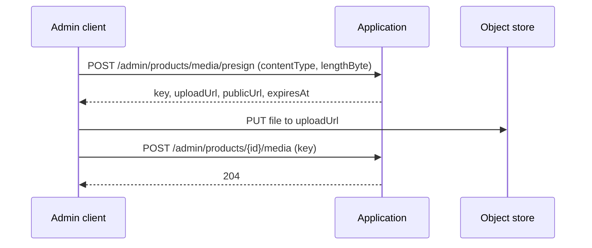

# Storage module

Storage keeps the files of the shop, which for now means **product images**. The files live in an S3-compatible object
store (SeaweedFS in development); the application never receives the image bytes itself.

- [How an image gets onto a product](#how-an-image-gets-onto-a-product)
- [How an image is shown](#how-an-image-is-shown)
- [Configuration](#configuration)
- [Code layout](#code-layout)
- [Current limits](#current-limits)

## How an image gets onto a product

The browser uploads straight to the object store, using a short-lived signed URL the API hands out. This keeps large
files off the application server.



1. **Ask for an upload URL.** The request gives the file's content type and size in bytes. The API checks them, picks a key, and returns a signed `uploadUrl` that is valid for a limited time (`presigned-duration-minutes`).
2. **Upload the file** to `uploadUrl` with a `PUT`, using the same content type and size you gave in step 1; the URL is created for them.
3. **Attach it to the product** by sending the `key` to the catalog's add-media endpoint.

Rules checked in step 1 (anything else is rejected with `400`):

| Rule | Value |
|---|---|
| Content types | `image/jpeg`, `image/jpg`, `image/png`, `image/webp`, `image/gif`, `image/svg+xml`, `image/avif` |
| Maximum size | 10 MB |
| Content type | Required, and case-insensitive |
| Size | Required, and greater than zero |

The **key** is `products/{random UUID}{extension}`, for example `products/3f2a…c1.png`. The extension comes from the
content type, never from a file name the client sends, and the random id means two uploads can never collide. The key
is what the catalog stores as the media id of a product or variant.

## How an image is shown

The database stores only the key. When a query returns a product, a cart line or a variant, it turns the key into a URL
the browser can open with `MediaUrlResolver`:

- A key such as `products/3f2a…c1.png` becomes `{publicBaseUrl}/products/3f2a…c1.png`.
- A value that already is a full URL (`http://`, `https://`) or a `data:` or `blob:` URI is returned unchanged.
- A missing or blank value gives `null`.

Because the browser loads images from `publicBaseUrl`, that address must be reachable from the browser, not only from
the server.

## Configuration

All settings are under `app.storage.s3` and are **required**: the application fails to start if one is missing.

| Setting | Meaning | Development value |
|---|---|---|
| `bucket` | Bucket that holds the images | `ecommerce` |
| `region` | Region name sent to the S3 client (SeaweedFS ignores its value) | `vietnam` |
| `endpoint` | S3 API address the application talks to | `http://localhost:8333` |
| `access-key`, `secret-key` | Credentials of the object store | `any` / `any` |
| `public-base-url` | Address the browser uses to read images | `http://localhost:8333/ecommerce` |
| `presigned-duration-minutes` | How long an upload URL stays valid | `15` |

The development object store is the `seaweedfs` service in `docker-compose.yml`. It exposes the S3 API on port `8333`,
and a web UI for browsing files on port `8888`. Path-style addressing (`endpoint/bucket/key`) is enabled because
S3-compatible servers expect it. The same code works with real S3 by changing the settings.

At startup the application checks that the bucket exists and **creates it if it does not**. If the object store cannot
be reached, the error is logged and the application keeps running; uploads then fail until it is available.

## Code layout

```
storage/
├── ProductMediaService.java    Validates an upload request and signs the upload URL; checks that a key exists
├── PresignedUploadRequest.java Input: content type and size
├── PresignedUploadResponse.java Output: key, upload URL, public URL and expiry
├── MediaUrlResolver.java       Turns a stored key into a public URL
├── StorageProperties.java      The `app.storage.s3` settings
└── S3Config.java               Builds the S3 client and signer, and creates the bucket at startup
```

The catalog exposes the upload through `POST /admin/products/media/presign` (see [catalog](catalog.md)), and catalog and
cart queries use `MediaUrlResolver` to return image URLs.

## Current limits

- **The server does not check that the file was really uploaded.** Adding a key to a product does not look in the object store, so a key whose upload failed or never happened is accepted. `ProductMediaService.exists` was written for this check but nothing calls it yet.
- **Files are not deleted.** Removing an image from a product removes only the key from the database; the file stays in the bucket.
- **SVG is accepted.** An SVG file can contain scripts, so files from the bucket should be treated as untrusted when they are served.
- **Only product images.** The key prefix and the service are specific to products; other kinds of files would need their own rules.
