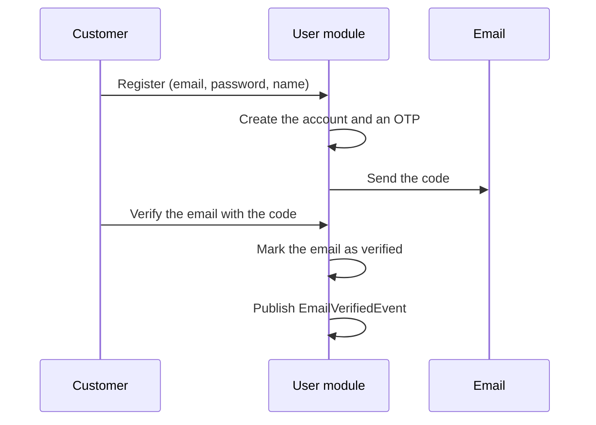
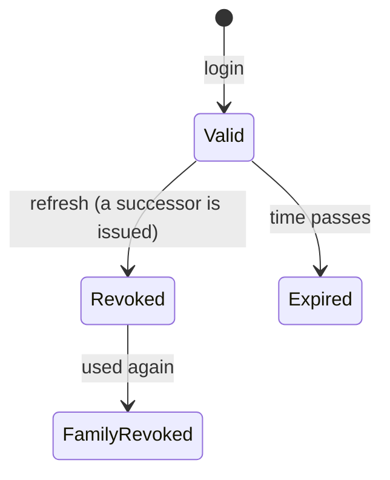

# User module

The user module owns accounts and how people prove who they are: registration, email verification, login, tokens,
password reset and the profile. For endpoint details (parameters, bodies, errors) use the Swagger UI at
`/swagger-ui.html`; this page explains the concepts and rules behind it.

- [Concepts](#concepts)
- [Rules](#rules)
- [Registration and email verification](#registration-and-email-verification)
- [Login and tokens](#login-and-tokens)
- [Password reset](#password-reset)
- [One-time codes](#one-time-codes)
- [Roles and access](#roles-and-access)
- [Events](#events)
- [API](#api)

## Concepts

| Concept | What it is |
|---|---|
| **User** | An account: email, hashed password, name, optional phone, avatar and address, a role and a status. |
| **Role** | `ROLE_CUSTOMER`, `ROLE_STAFF` or `ROLE_ADMIN`. A new account is always a customer. |
| **Status** | `ACTIVE`, `INACTIVE`, `BLOCKED` or `PENDING_VERIFICATION`. A new account is `ACTIVE`. |
| **OTP** | A 6-digit one-time code sent by email, to verify an email or to reset a password. |
| **Access token** | A short-lived JWT that proves who is calling. It carries the user id, email and role. |
| **Refresh token** | A longer-lived token used only to get a new pair of tokens. |

## Rules

- **The email is the login.** It is trimmed, lower-cased and must be unique.
- **A password has 8 to 128 characters** with at least one uppercase letter, one lowercase letter and one digit. It is stored only as a hash.
- **A phone number is 9 to 11 digits** with an optional country prefix. Spaces, dots and dashes are ignored.
- **A blocked account cannot log in or refresh tokens.** An admin account cannot be blocked.
- **An unverified account can log in, but cannot buy.** Cart, checkout and orders need a verified email (see [Roles and access](#roles-and-access)). Verifying the email also creates the user's cart.
- **Nothing reveals which emails exist at login.** An unknown email and a wrong password give the same answer.

## Registration and email verification

1. **Register.** The account is created as a customer, active, with an unverified email. An email-verification OTP is
   created and sent in the same step.
2. **Verify.** The customer sends the code. When it is right, the email is marked as verified and `EmailVerifiedEvent`
   is published; the cart module reacts to it by creating the customer's cart.
3. **Ask again.** If the code was lost or expired, the customer can request a new one for an account that is not
   verified yet. Verifying an email that is already verified is rejected.

## Login and tokens

Login exchanges an email and a password for an **access token** and a **refresh token**, and records the last login time.
The password is checked before the status, so a blocked account is only reported to someone who knows its password.

The refresh token is used once. Asking for a new pair with it revokes it and issues its successor, in the same **token
family** (all the tokens descended from one login):

- Using a token that was already revoked, or losing a race to revoke it, is treated as theft: the whole family is
  revoked, so every session descended from that login is signed out. The answer is an error, but the revocation is kept.
- Refresh tokens are stored only as a SHA-256 hash, so a leaked table cannot be used to sign in.
- The access token says whether the email was verified when the token was issued. A customer who verifies their email
  keeps an "unverified" token until it expires, so the client refreshes the tokens right after verifying to get one that says
  "verified".
- Changing or resetting the password revokes all of the user's refresh tokens. Access tokens already issued stay valid until
  they expire, so lifetimes should be short. They are set by `JWT_ACCESS_TOKEN_VALIDITY` and `JWT_REFRESH_TOKEN_VALIDITY`.

## Password reset

1. **Request.** The customer gives their email and gets a password-reset OTP by email.
2. **Reset.** The customer sends the email, the code and the new password. The password is changed and all of the user's
   refresh tokens are revoked.

A signed-in user who knows the current password can change it directly, which also signs them out of every other device.

## One-time codes

| | Email verification | Password reset |
|---|---|---|
| **Valid for** | 5 minutes | 3 minutes |
| **Wrong attempts allowed** | 5 | 3 |

- **Every attempt is counted, including a wrong code.** The count is saved even when the check fails, so the limit cannot
  be avoided by making the request fail.
- **A code works once.** It cannot be used after it was used, expired or ran out of attempts.
- **Asking for a new code makes the old ones useless.**
- **Requesting codes is rate limited**, so the endpoint cannot be used to flood someone's mailbox or to guess codes:
  - at least 60 seconds between two requests while the last code is still valid;
  - 15 minutes of waiting after a code ran out of attempts;
  - at most 5 requests per account in 24 hours.

  A request that breaks a rule is answered with 429.

## Roles and access

| Who | Can use |
|---|---|
| Anyone | `/auth/**`, the API docs, product and category reads, and the list of payment gateways |
| Any signed-in user | Their own account: profile, password change |
| A signed-in user with a verified email | `/cart/**`, `/checkout/**` and `/orders/**` |
| `ROLE_STAFF` and `ROLE_ADMIN` | `/admin/**` |
| `ROLE_ADMIN` only | `/admin/users/**` |

Requests are authenticated by the access token alone, with no session. For each request the token is turned into a set of
authorities: the user's role, plus `EMAIL_VERIFIED` when the token says the email is verified. Routes then require the role
or the authority they need. A missing or invalid token is answered with 401, and a signed-in user without the right role or
a verified email with 403.

## Events

The user module publishes events and sends the emails itself when it receives them, so the use cases never wait for the
mail server.

| Event | Published when | What happens |
|---|---|---|
| `UserRegisteredEvent` | An account is registered | The verification code is emailed |
| `EmailVerificationRequestedEvent` | A new verification code is requested | The code is emailed |
| `PasswordResetRequestedEvent` | A password reset is requested | The code is emailed |
| `EmailVerifiedEvent` | An email is verified | Used by other modules, such as cart |

See [Event publication registry](event-publication-registry.md) for how events are delivered and kept.

## API

| Endpoint | What it does |
|---|---|
| `POST /auth/register` | Create a customer account |
| `POST /auth/send-verification-otp` | Email a new verification code |
| `POST /auth/verify-email` | Verify the email with the code |
| `POST /auth/login` | Get an access token and a refresh token |
| `POST /auth/refresh-token` | Exchange a refresh token for a new pair |
| `POST /auth/forgot-password` | Email a password-reset code |
| `POST /auth/reset-password` | Set a new password with the code |
| `GET /users/me` | My account |
| `PUT /users/me/profile` | Change my name, phone and avatar |
| `PUT /users/me/password` | Change my password |
| `GET /admin/users` | Search users (admin) |
| `GET /admin/users/{id}` | Get a user (admin) |
